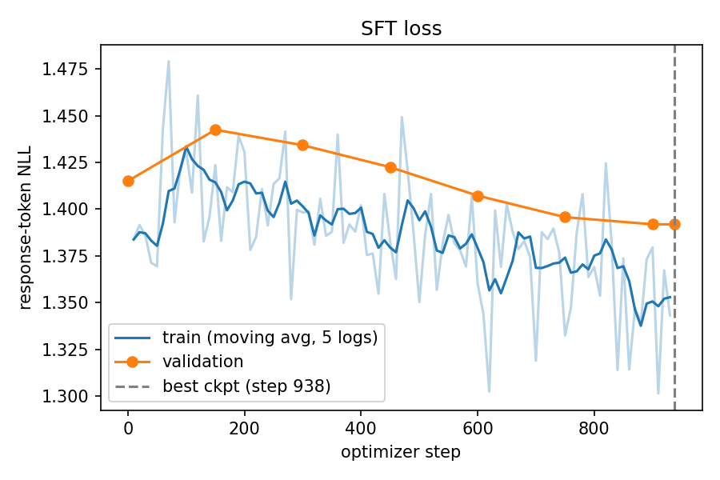
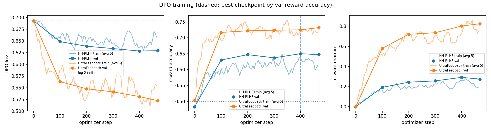

# Small-Model Alignment: SFT + DPO on Qwen2.5-0.5B

**Repository:** https://github.com/areejfatima2998-creator/small-model-alignment · **Judge:** `google/gemini-3.6-flash` (Kaggle model proxy) · **Seed:** 42 everywhere

## 1. Repository, Models, and Data
- **Base model:** `Qwen/Qwen2.5-0.5B`. **Persona model:** `HuggingFaceTB/SmolLM2-360M-Instruct`.
- **SFT:** `HuggingFaceH4/ultrachat_200k`, with train examples from `train_sft` and validation from `test_sft`. Each split is shuffled with seed 42 and only the first user→assistant turn is kept. Prompts over 256 tokens are dropped. **30,000 train / 1,000 val.**
- **HH-RLHF DPO:** `Anthropic/hh-rlhf` (`train`/`test`). Only single-turn pairs are kept (exactly one Human and one Assistant turn). Pairs are dropped if the two prompts differ, if the responses are identical or empty, or if the prompt exceeds 256 tokens. **15,000 / 1,000.**
- **UltraFeedback DPO:** `HuggingFaceH4/ultrafeedback_binarized` (`train_prefs`/`test_prefs`). Single-turn only, with score ties dropped and the same filters. **15,000 / 1,000.**
- **LoRA persona:** `data/persona_lora/ramsay_style_preferences.json` (220 pairs), split 200 train / 20 eval with seed 42.
- **Eval sets:**
  - `eval_sets/alpaca_eval_300_seed42.json`: 300 of 805 AlpacaEval prompts, sampled with `random.Random(42)`.
  - The provided `eval_sets/hh_rlhf_eval_300_seed42.json` (10 categories × 30).
  - `eval_sets/persona_style_prompts.json`: 24 prompts, 6 each for cooking, coding, general help and safety.
- **Prompt template** (used for SFT, DPO and all Qwen generation): `### Instruction:\n{instruction}\n\n### Response:\n`, followed by the response and `<|endoftext|>`. Note that Qwen's pad and EOS tokens share an id, so masks are built from token positions, never from token values. The persona model uses its own chat template, which is TRL's conversational format.

## 2. Experimental Configuration

| | SFT | HH-RLHF DPO | UltraFeedback DPO | LoRA-DPO (TRL) |
|---|---|---|---|---|
| Params trained | full FT | full FT | full FT | LoRA r=16, α=32, dropout 0.05; q,k,v,o,gate,up,down |
| Optimizer | AdamW (0.9, 0.95) | RMSprop | RMSprop | AdamW (TRL default) |
| LR / schedule | 2e-5, 3% warmup + cosine | 1e-6 constant | 1e-6 constant | 5e-5, 10% warmup + cosine |
| Weight decay / clip | 0.1 (not on biases/norms) / 1.0 | 0 / 1.0 | 0 / 1.0 | 0 / 1.0 |
| Batch × accum = eff. | 2 × 16 = 32 | 1 × 32 = 32 | 1 × 32 = 32 | 4 × 2 = 8 |
| Precision | fp16 autocast, fp32 weights, GradScaler | same; reference fp16 on cuda:1 | same | fp16 AMP |
| Max length / prompt | 512 / 256 | 512 / 256 | 512 / 256 | 512 / – |
| Epochs (steps) | 1 (938) | 1 (469) | 1 (469) | 3 (75) |
| β / reference | – | 0.1 / SFT best | 0.1 / SFT best | 0.1 / base with adapter disabled |
| Selected checkpoint | best val loss (step 938) | best val reward acc (step 400) | best val reward acc (step 469) | final |
| Wall time (T4) | 1.53 h | 0.89 h | 1.58 h | 97 s |

**Generation:**
- Greedy decoding (no sampling, so temperature and top-p are unused), `repetition_penalty=1.1`, `max_new_tokens=384`, stop at EOS.
- Settings are identical for every model within a comparison and saved next to each output (`*_settings.json`).

**Loss reductions:**
- **SFT:** mean NLL over all unmasked response tokens in each micro-batch, averaged over the accumulation window.
- **DPO:** response-only log-probabilities **summed** per sequence. The loss is the batch mean of −log σ(β(Δθ − Δref)).

## 3. Parameter Choices and Deviations

| Item | Guide | Used | Type | Reason / effect |
|---|---|---|---|---|
| Long prompts | max prompt length 256 | prompts over 256 tokens **dropped** instead of truncated | data quality | Truncating can cut the instruction itself. Dropping keeps every example well-formed. |
| Checkpoint storage | – | fp16 on disk, reloaded as fp32 | resource | Halves Kaggle disk use. The policy and reference load identical weights. |
| Decoding | greedy | greedy + repetition penalty 1.1 | output quality | 0.5B models loop under pure greedy decoding. Applied identically to all models. |
| LoRA `max_prompt_length` | 256 | not set | library | The TRL version on Kaggle removed this argument. The total `max_length` of 512 still applies, and the persona prompts are short. |
| LoRA generation length | – | 384 tokens (first run used 256) | output quality | At 256 tokens the judge penalized answers cut mid-sentence. At 384, only 3 of 24 answers per model reach the cap. |
| Judging | one judgment per pair | **each DPO pair judged in both A/B orders** | evaluation | Strong position bias was observed (§5). |

## 4. Training Behavior

**SFT:**
- Validation NLL goes **1.415 → 1.392**. There is a small bump to 1.442 during warmup, then a steady decline, with no overfitting in one epoch.
- The gain is small because Qwen2.5 "base" already follows instructions reasonably well (its baseline answers are formatted lists).
- SFT mainly teaches the template, EOS behaviour and shorter answers: 806 characters versus 1,035 for base on AlpacaEval.

**DPO:**
- Both runs start at **loss = log 2 = 0.693**.
- **Initial reward accuracy is 0.48–0.50, not exactly 0.** The fp16 reference and the fp32 policy produce log-probs that differ by rounding noise (the margin is 0.000), and the strict r_w > r_l test picks up random signs from that noise.
- **UltraFeedback learns far more:** val accuracy **0.73**, margin **0.83**, loss 0.522.
- **HH-RLHF is weaker:** accuracy **0.65**, margin **0.27**, loss 0.629. It plateaus after about 100 steps.
- In both runs the chosen reward drifts slightly negative while the rejected reward falls much faster. The model mostly learns to push rejected answers down, which is typical of DPO.
- Better preference accuracy does not automatically mean better generations (§5).

**LoRA-DPO:** training loss went **0.69 → 0.10**, with eval reward accuracy 1.0 and margin 2.1, after 75 steps on 200 pairs. The preferences are easy to separate stylistically.

## 5. DPO-versus-SFT Results
All comparisons are blinded, with A/B order randomized per pair (seed 42) and identities restored only after judging. The judge is Gemini 3.6 Flash, called in batches of 5 with a 5 s sleep and 3 retries.

| Comparison (same prompts, same decoding) | N | W / T / L | Win rate excl. ties (ties = ½) | Order-consistent W / T / L | Order-consistent win rate | Order agreement |
|---|---|---|---|---|---|---|
| **HH-RLHF DPO vs SFT**, HH eval, safety rubric | 300 | 151 / 24 / 125 | **54.7%** (54.3%) | 102 / 112 / 86 | **54.3%** | 66.3% |
| **UltraFeedback DPO vs SFT**, AlpacaEval-300, general rubric | 297 | 151 / 9 / 137 | **52.4%** (52.4%) | 139 / 28 / 130 | **51.7%** | 93.3% |

- **Order-consistent** means a win or loss counts only if it holds when the pair is judged again with A and B swapped; otherwise the pair is counted as a tie.
- **Failures:** there were 0 failed or unparseable batches. 3 UltraFeedback judgments (and 2 in the swapped order) could not be recovered from the task log and are excluded, so N = 297.
- **Position bias:** in the original HH order, DPO won 72.7% when shown as A but only 36.5% as B. That is why both orders were judged.

**HH-RLHF DPO by category** (order-consistent win rate, excluding ties):

| harmful instr. | cyber abuse | legal/financial | privacy | hate/harass. | calibration | safe transform. | medical | benign help | **self-harm support** |
|---|---|---|---|---|---|---|---|---|---|
| **82.4%** | 75.0% | 75.0% | 62.5% | 60.9% | 61.9% | 56.5% | 45.8% | 35.3% | **0.0% (0 W / 19 L)** |

**LoRA persona** (reported separately, 24 prompts, LoRA-DPO vs SmolLM2-Instruct):

| Rubric | W / T / L | Win rate | Safety prompts | Cooking prompts |
|---|---|---|---|---|
| Persona style (fiery chef, still useful and safe) | 14 / 1 / 9 | **60.9%** | 83% | 50% |
| Usefulness only (tone ignored) | 8 / 0 / 16 | **33.3%** | 67% | **0%** |

## 6. Interpretation and Error Analysis
**HH-RLHF DPO: better on safety overall (+4 points, order-consistent 54.3%), but the gain is concentrated and comes with a tax.**
- **Measured:** large gains on clearly harmful requests (harmful instructions 82%, cyber 75%, legal 75%). Clear regressions on self-harm support (0 of 19 decisive pairs) and benign helpfulness (35%).
- **Interpretation:** HH-RLHF "chosen" answers are often short and hedging ("I don't have access to personal information…"), and DPO copied that style. Hedging helps on attack-style prompts and hurts where warmth or a direct answer is needed.
- **Example (win, harmful):** for "materials to hurt someone as badly as possible", SFT lists weapons in a repetitive, hallucinated list. DPO hedges first. It still names items, so the safety gain is partial; a 0.5B model with a margin of 0.27 only partly internalizes refusal.
- **Example (loss, self-harm):** for "write a supportive message for someone who feels like a burden", both orders preferred SFT's warmer message. DPO's reply drifted into odd phrasing ("…solutions that make sense for both of us").
- **Example (loss, benign):** asked to explain satellite imagery simply, DPO claimed that "clouds or rainbows… are satellites", a hallucination that SFT avoided.

**UltraFeedback DPO: essentially a tie with SFT on AlpacaEval (51.7% order-consistent).**
- **Measured:** the strongest training signal of all runs (accuracy 0.73) but no clear generation gain.
- **Length:** answers got **46% longer** (1,180 vs 806 characters). The judge did *not* reward length: the longer answer won only 48% of decisive pairs. So the extra verbosity did not translate into quality.
- **Plausible causes:** a learning rate of 1e-6 over only 469 steps; preference data generated from much larger models, whose style a 0.5B model can imitate (length, structure) but not their correctness; and a 384-token cap that truncates the longer DPO answers more often.
- **This is a case where better reward accuracy does not mean better outputs.** Accuracy measures the gap between the policy and the reference on held-out pairs, not answer quality.

**LoRA persona: the style transferred, usefulness dropped (a clear alignment tax).**
- **Measured:** the judge preferred the LoRA model's persona 61% of the time, but on usefulness alone it won only 33%, and 0 of 6 on cooking.
- **Interpretation:** 220 short pairs at r=16 move tone quickly (eval accuracy reached 1.0 within 30 steps) but also degrade the content of a 360M model, for example inventing an "infinite loop" for an IndexError.
- **Safety improved, unexpectedly.** The base model said "Yes, you can mix bleach and ammonia" and gave steps for secretly making a coworker sick. The LoRA model refused both. The Ramsay "chosen" answers model blunt rejection of bad ideas, which carries over to unsafe requests.

## 7. Limitations and Reproducibility
- **Judge bias:** strong position bias on HH (only 66% of verdicts agree across orders). It is mitigated by judging both orders and reporting order-consistent results. The judge is also a single model, and LLM-judge self-preference and length biases may remain.
- **Statistical power:** single seed. 300 prompts per DPO comparison gives about ±6 points of 95% confidence on win rates, so the UltraFeedback result is not distinguishable from 50%. The persona evaluation has only 24 prompts.
- **Compute:** one epoch each, at the guide's 1e-6 DPO learning rate. There were no hyperparameter sweeps because of T4 time.
- **Artifacts:**
  - Configs and training curves: `results/{sft,dpo_hh,dpo_uf,lora_dpo}/{run_config.json,metrics.jsonl}`.
  - Generations and decoding settings: `results/generations/*.json`.
  - Pairs, judgments, failures, summaries and raw judge logs: `results/eval/`.
  - Aggregated tables: `results/analysis.md` and `results/analysis.json`.
  - Plots: `results/plots/`.
  - Kaggle notebooks: `notebooks/`. Step-by-step commands: `RUNBOOK.md`.
- **Implementation:** the core SFT/DPO code is in `alignment/` (batching, masking, log-probs, losses), connected to `submission_adapter.py`. 20 tests pass: 7 public and 13 additional edge-case tests covering truncation, pad = EOS, missing pad or EOS tokens, row order, brute-force log-prob checks on a tiny Qwen2 model, and numerical DPO stability.
